# Forensic live : artefacts volatils et persistants
### Windows Server AD (GOAD-MINI) et Kali Linux

Collecte, interprétation et corrélation d'artefacts forensics sur un contrôleur de domaine Windows et une machine Kali, selon l'**ordre de volatilité de la [RFC 3227](https://datatracker.ietf.org/doc/html/rfc3227)**. Chaque manipulation est documentée avec sa commande, son résultat, son interprétation et sa logique métier.

> **Labo utilisé** : environnement basé sur [GOAD (Game Of Active Directory)](https://github.com/Orange-Cyberdefense/GOAD), projet open source d'[Orange Cyberdefense](https://github.com/Orange-Cyberdefense) ([documentation officielle](https://orange-cyberdefense.github.io/GOAD/)). GOAD et ses scénarios appartiennent à leurs auteurs ; ce dépôt n'en est ni une copie ni un fork, il documente uniquement mon analyse forensic sur ma propre instance de laboratoire.

## Objectif

Montrer comment un **artefact** (indice technique brut) devient une **preuve** (indice daté, attribué, corroboré et traçable). Le fil conducteur : collecter du plus volatil au moins volatil, puis recouper plusieurs sources indépendantes.

## Périmètre

| Élément | Détail |
|---|---|
| Windows | `kingslanding`, contrôleur de domaine `sevenkingdoms` ([labo GOAD](https://orange-cyberdefense.github.io/GOAD/)), session `Domain Admins` |
| Linux | Kali `pentest` (zsh, journald, wtmpdb) |
| Niveaux RFC 3227 couverts | 2 (réseau, ARP), 3 (processus), 5 (disque : fichiers récents, registre, historiques, journaux) |
| Hors périmètre | Image mémoire complète, image disque, analyse de timeline MFT |
| Règle | Lecture seule, hors démonstrations contrôlées listées dans le journal des actions |

GOAD est un labo à vulnérabilités volontaires : il n'est pas représentatif d'une production. Un contrôleur de domaine génère aussi beaucoup de trafic légitime (Kerberos, LDAP, RPC).

## Méthode

1. Horodater chaque collecte en **UTC** (la VM Windows est en UTC-7, journald en UTC+1).
2. Collecter du plus volatil au moins volatil : réseau, ARP, processus, puis disque.
3. Trier : attendu pour le rôle de la machine, externe à vérifier, anormal.
4. Attribuer : processus, chemin, signature, utilisateur, heure.
5. Corroborer par au moins deux sources indépendantes avant de conclure.
6. Consigner toute action de l'analyste (principe de Locard).

---

# Partie 1 : Windows (contrôleur de domaine)

## 1.0 Contexte
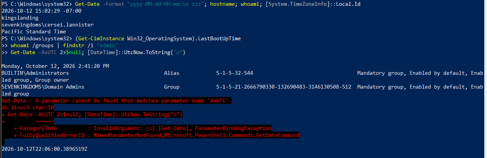

Relevé de l'heure locale, de l'UTC, de l'hôte, du compte et du dernier boot. Le boot date d'environ 25 minutes : les artefacts volatils sont donc jeunes.

## 1.1 Connexions réseau : `netstat -ano`
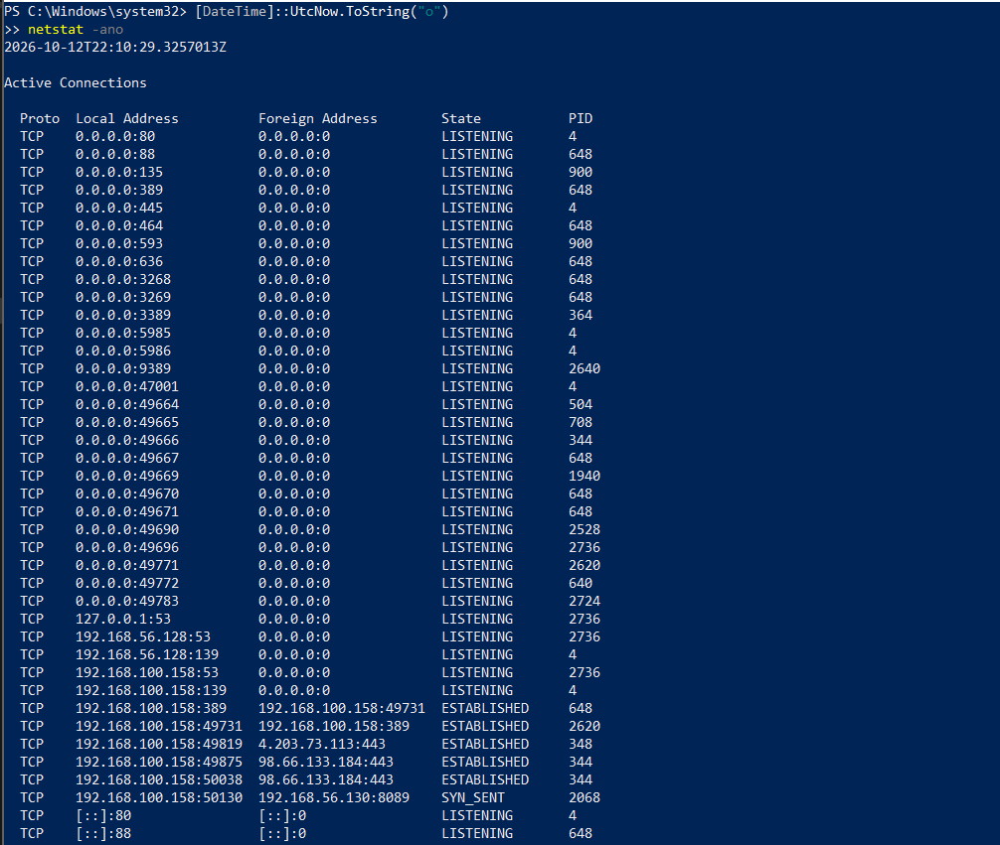
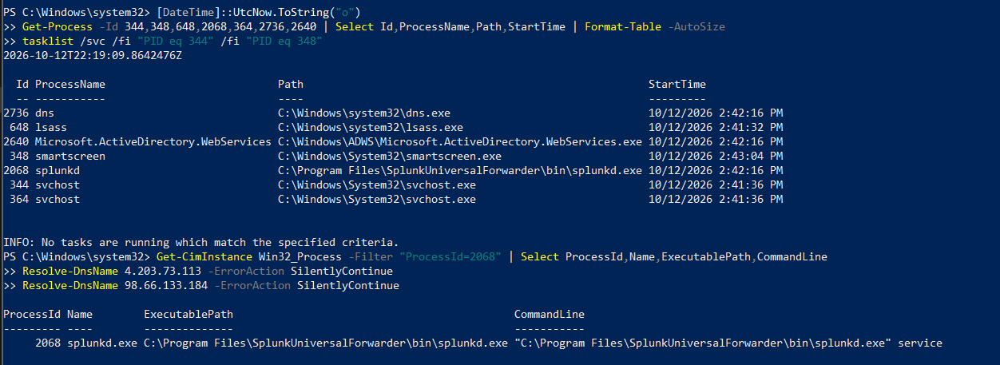

**Ce que ça montre** : les sockets, leur état et le PID propriétaire. L'état est une photo à l'instant T, stockée dans le noyau (RAM).

**Constats** : 62 ports TCP en écoute (services AD attendus : 53, 88, 135, 389, 445, 464, 636, 3268, 3389, 5985, 9389), 23 connexions établies dont 20 internes (LDAP et RPC entre services du DC).

**Triage des flux sortants** :

| Flux | PID | Processus | Verdict |
|---|---|---|---|
| HTTPS vers une IP externe | 348 | `smartscreen.exe` (System32), signature Microsoft valide | Légitime |
| HTTPS vers une autre IP externe (2 connexions) | 344 | `svchost.exe` (16 services hébergés) | Compatible Windows Update ou notifications ; service exact non déterminable avec netstat |
| `SYN_SENT` vers `192.168.56.130:8089` | 2068 | `splunkd.exe` (Universal Forwarder), signature Splunk valide | Le forwarder n'atteint pas son serveur : angle mort de détection |

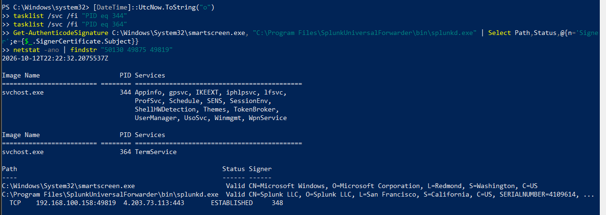

**Volatilité démontrée** : 12 minutes plus tard, les deux connexions du PID 344 et le `SYN_SENT` avaient disparu de la table, sans aucune action de ma part. Un enquêteur arrivant plus tard n'aurait aucune trace de ces communications.

**Logique métier** : le nom d'un processus ne prouve rien (`svchost` est un masque classique). Le triage combine chemin, signature numérique, service hébergé, heure de démarrage et cohérence avec le rôle de la machine.

## 1.2 Processus : `tasklist`

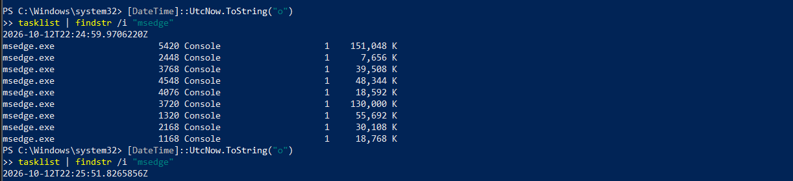

**Constats** : Edge apparaissait sous 9 processus avec un seul onglet (architecture multi-processus). Après fermeture, plus aucun : mémoire libérée, PID recyclables.

**Logique métier** : un enquêteur raisonne en arborescence parent-enfant, pas en PID isolé. Un processus qui se termine ne laisse plus de trace dans la liste. Un malware uniquement en mémoire disparaît à l'extinction : d'où la capture de la RAM **avant** d'éteindre.

## 1.3 Cache ARP : `arp -a`
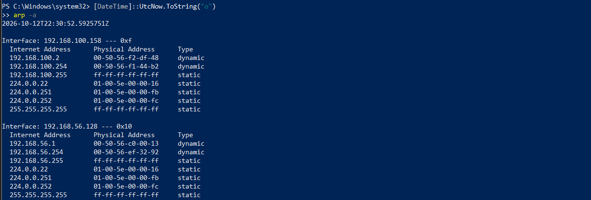

**Constats** : quatre voisins dynamiques, tous avec le préfixe MAC VMware (`00-50-56`), aucun doublon de MAC. Le serveur Splunk est absent du cache, et la connexion `SYN_SENT` partait de l'interface NAT et non de l'interface host-only : piste probable de la cause (non confirmée par `route print`).

**Logique métier** : le cache ARP associe une IP à une MAC au moment de l'attaque. Lors d'une usurpation ARP, l'association frauduleuse n'existe que dans le cache de la victime. Perdue à l'extinction, elle prive l'enquêteur de la MAC de l'attaquant et donc de sa localisation sur le switch.

## 1.4 Fichiers récents : `shell:recent`
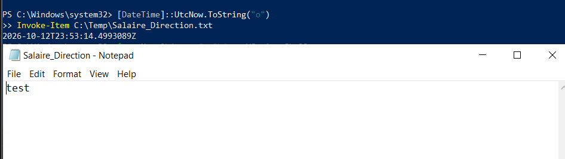

**Constats** : raccourcis `.lnk` de mes propres fichiers de travail, antérieurs au dernier boot : ils ont **survécu au redémarrage**, contrairement à netstat et tasklist.

**Démonstration contrôlée** avec un fichier `Salaire_Direction.txt` :

| Action | Résultat |
|---|---|
| Ouverture en ligne de commande (`notepad <chemin>`) | Aucun raccourci créé |
| Ouverture via le shell (`Invoke-Item`) | Raccourci créé, cible et dates enregistrées |
| Suppression du fichier (`Remove-Item`) | Le raccourci **survit** |

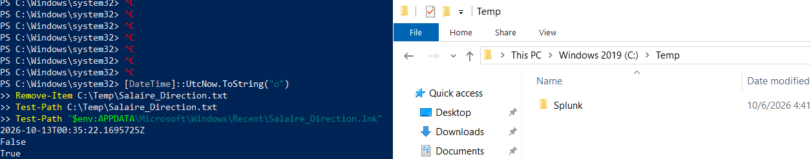

**Logique métier** : le raccourci atteste qu'un fichier a existé et a été ouvert depuis un profil précis, même supprimé, ce qui contredit un « je n'y ai jamais touché ». Il devient une preuve avec l'attribution (compte et session), la datation, la corroboration (Jump Lists, journaux) et l'intégrité. **Limite** : l'absence de raccourci ne prouve pas l'absence d'accès.

## 1.5 Registre : RunMRU
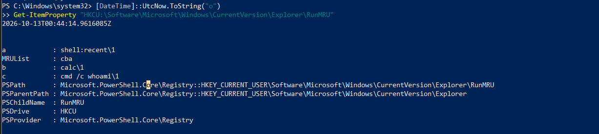

**Constats** : `calc`, `cmd /c whoami` et `shell:recent`, avec `MRUList` donnant l'ordre (du plus récent au plus ancien).

**Logique métier** : la clé liste ce qu'une personne a **tapé à la main** dans la boîte Exécuter. Elle prouve une session interactive et relie des actions à un compte (la clé est dans le profil utilisateur). `cmd /c whoami` imite la première reconnaissance d'un attaquant. **Limites** : seule la boîte Exécuter est enregistrée, sans horodatage par entrée, et un attaquant peut effacer la clé.

---

# Partie 2 : Linux (Kali)

## 2.1 Connexions réseau : `ss -tunap`
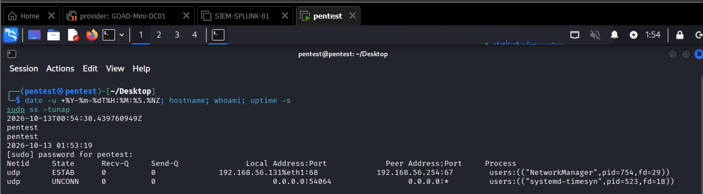
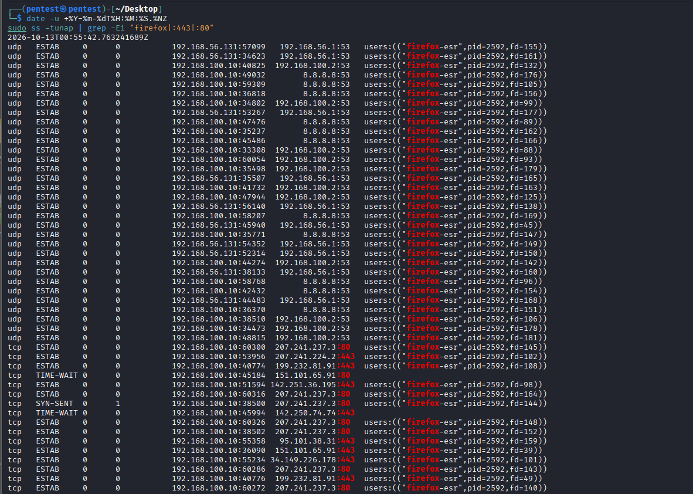

**Constats** : au repos (Kali démarrée depuis 71 s), deux sockets UDP seulement (DHCP et synchronisation de l'heure) et aucune connexion TCP. Après ouverture de Firefox, 48 sockets, tous attribués au processus `firefox-esr` : 32 requêtes DNS vers trois résolveurs, 13 connexions établies, 1 en attente, 2 en `TIME-WAIT` (le noyau les garde, sans processus). Après fermeture, plus aucune ligne Firefox.

**Logique métier** : `ss -p` relie une destination à un processus. Lors d'une exfiltration, perdre cette table fait perdre le serveur de destination, le processus responsable et la preuve que le transfert était en cours.

## 2.2 Processus : `ps`, arbre et `/proc`
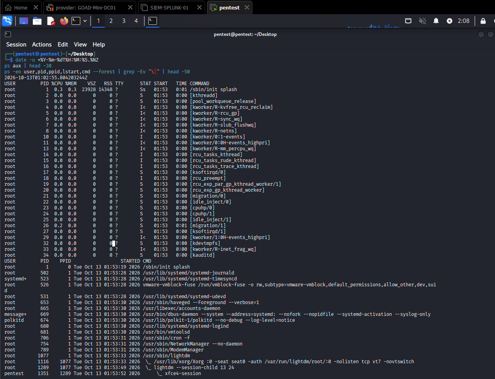
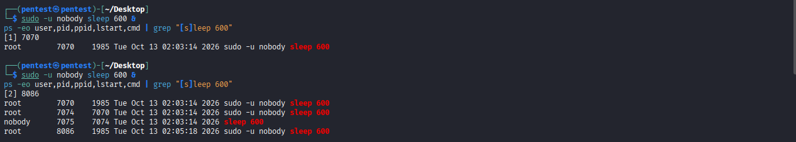

**Constats** : services système en root ou comptes dédiés, session de bureau descendant de `lightdm`, tous les lancements dans la session de boot. Aucun faux thread noyau (contrôle : nom entre crochets avec un parent différent de PID 2).

**Démonstration d'usurpation** : un `sleep` lancé sous le compte `nobody` via `sudo` depuis mon shell.

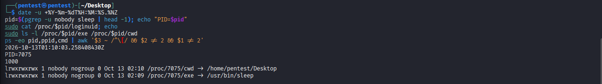

| Source | Ce qu'elle apprend |
|---|---|
| `ps` | Processus `nobody`, parent `sudo`, lui-même enfant de mon shell |
| `/proc/<pid>/loginuid` | UID d'origine : 1000, conservé à travers `sudo` |
| `/proc/<pid>/exe` | Binaire légitime `/usr/bin/sleep` |
| journald | Ligne `sudo` : utilisateur d'origine, terminal, répertoire, commande |

**Logique métier** : la colonne USER de `ps` est l'utilisateur **effectif** et peut tromper. Quatre sources indépendantes désignent le même auteur : c'est la corroboration qui fait la preuve.

## 2.3 Cache ARP : `ip neigh`
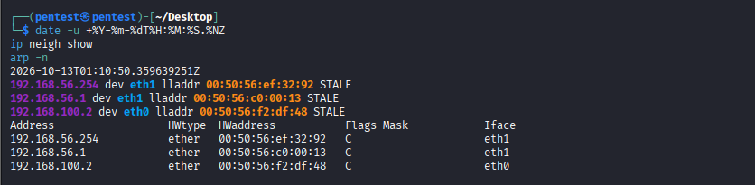

**Constats** : trois voisins, tous `STALE` (conservés mais non revérifiés), sans doublon. Leurs associations IP/MAC sont **identiques** à celles vues depuis Windows : deux observateurs indépendants concordent, ce qui rend l'usurpation ARP très improbable.

**Logique métier** : le cache est en RAM de l'hôte. Un switch conserve une table MAC vers port (CAM), elle aussi volatile : après son redémarrage, on perd la localisation physique de l'attaquant.

## 2.4 Historique des commandes
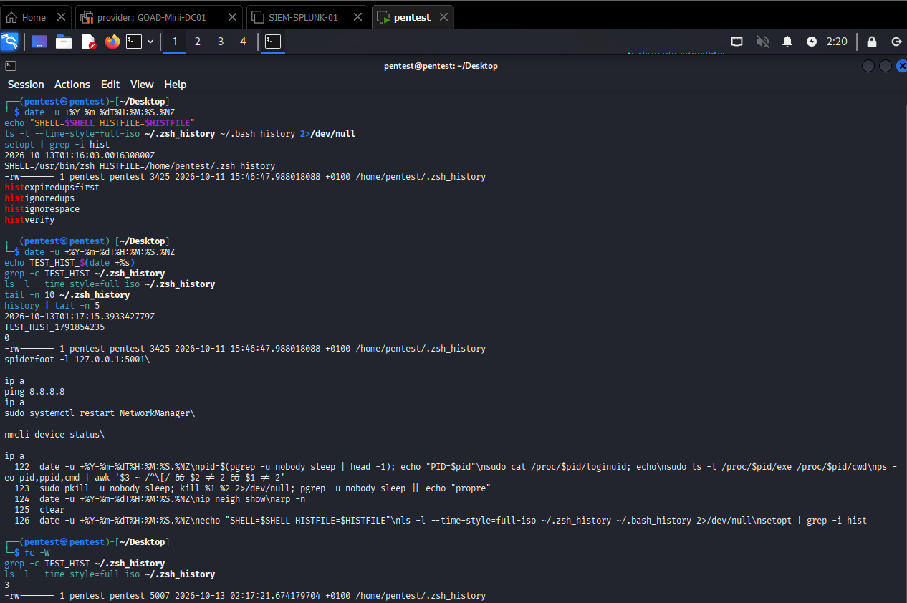

**Constat** : un test montre que zsh n'écrit pas en temps réel. Une commande marquée est absente du fichier (0 occurrence, fichier inchangé) jusqu'à un forçage `fc -W` (3 lignes, fichier modifié). Les commandes de la session précédente, elles, sont déjà dans le fichier.

**Logique métier** : une coupure brutale perd toutes les commandes de la session en cours. L'option `histignorespace` permet aussi à un attaquant de ne rien laisser en préfixant sa commande d'un espace.

## 2.5 Effacement des traces
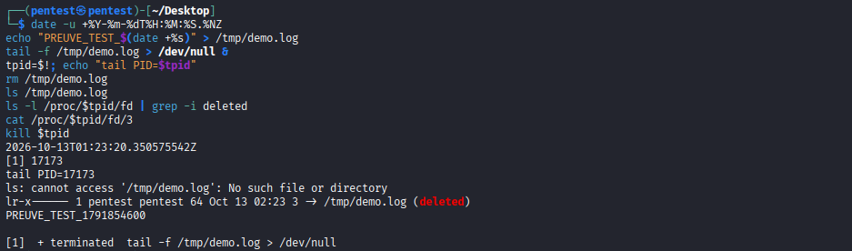

**Démonstration** : un fichier supprimé reste lisible via `/proc/<pid>/fd/3` tant qu'un processus le garde ouvert.

**Logique métier** : `rm` retire le nom, pas les données. Les blocs restent dans l'espace non alloué jusqu'à réécriture, et les démons de journalisation gardent leurs fichiers ouverts. On n'éteint donc pas une machine compromise avant d'avoir collecté. `history -c` ne vide que la mémoire du shell : les sessions précédentes, la RAM, `sudo` dans journald et les logs distants restent exploitables.

## 2.6 Journaux d'authentification
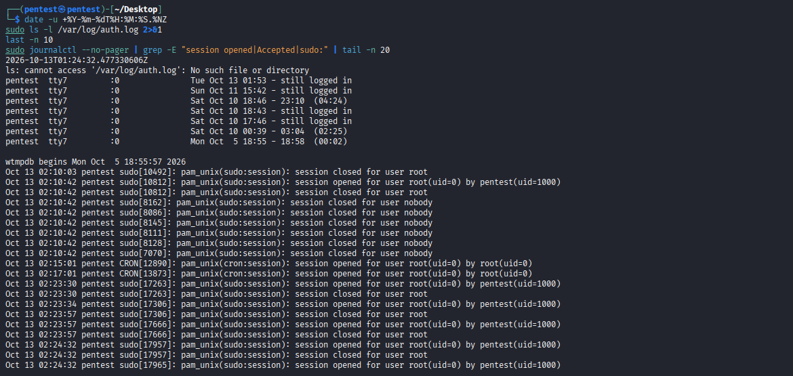
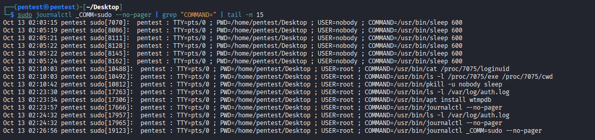

**Constats** : pas de `auth.log` (journald, format binaire). `last` ne montre que des sessions locales, plusieurs sans fermeture enregistrée : arrêt brutal de la VM (hypothèse). Journald trace chaque `sudo` avec utilisateur, terminal, répertoire et commande.

**Artefact ou preuve ?** Une ligne `session opened` isolée est un artefact : elle ne dit ni qui est derrière le clavier, ni si c'était autorisé. Elle devient une preuve d'intrusion quand le contexte la rend illégitime : origine inconnue, heure inhabituelle, rafale d'échecs avant succès, actions anormales après (élévation, effacement des logs), le tout recoupé avec d'autres sources. Ici, chaque ligne se corrèle à une commande de ma chronologie : bénigne.

---

# Partie 3 : scénario rançongiciel

Une machine d'entreprise est chiffrée, l'écran affiche la demande de rançon, la machine fonctionne encore.

**Pourquoi ne pas couper l'alimentation** :
1. La RAM contient le processus malveillant, ses connexions vers le serveur de commande, les sessions et parfois les **clés de chiffrement**, potentiellement récupérables.
2. Une coupure en plein chiffrement laisse des fichiers corrompus et des données non écrites perdues, et un redémarrage peut relancer le malware.

**Bonne réaction** : isoler du réseau (câble, carte, VLAN de quarantaine) sans éteindre, puis collecter dans l'ordre : RAM, réseau, processus, image disque avec protection en écriture et empreinte.

**Rapport** : phase finale du processus (restitution), qui doit respecter la chaîne de custody, l'intégrité (empreintes), la reproductibilité, la légalité (mandat, protection des données personnelles), l'objectivité (faits séparés des hypothèses) et la clarté pour un public non technique.

---

## Limites

- Labo à vulnérabilités volontaires, non représentatif d'une production.
- Les destinations externes ne sont pas attribuées par whois : ce sont des hypothèses.
- Un `svchost` regroupe plusieurs services : netstat ne suffit pas à désigner le service.
- Pas d'image mémoire ni d'image disque : le niveau d'analyse reste celui d'une collecte live.

## Journal des actions de l'analyste

Tout ce qui a modifié les systèmes, à exclure de l'analyse :

| Système | Action |
|---|---|
| Windows | Dossier de travail et fichiers de notes, fichier de démo créé, ouvert puis supprimé, entrées dans la boîte Exécuter, Edge ouvert puis fermé |
| Kali | Navigation Firefox, six `sudo -u nobody sleep` et un fichier temporaire de démo, `fc -W` (écriture forcée de l'historique), `apt install wtmpdb`, commandes `sudo` d'enquête (lignes dans journald) |

## Compétences démontrées

Collecte selon l'ordre de volatilité, triage de connexions et de processus, vérification de signatures, lecture de journaux Windows et Linux, corrélation multi-sources, attribution, rigueur de documentation (horodatage UTC, limites, journal des actions) et restitution claire pour un lecteur technique comme non technique.

## Références

- [GOAD (Game Of Active Directory), Orange Cyberdefense](https://github.com/Orange-Cyberdefense/GOAD) : dépôt officiel du labo
- [Documentation officielle de GOAD](https://orange-cyberdefense.github.io/GOAD/)
- [RFC 3227, Guidelines for Evidence Collection and Archiving](https://datatracker.ietf.org/doc/html/rfc3227) : ordre de volatilité
